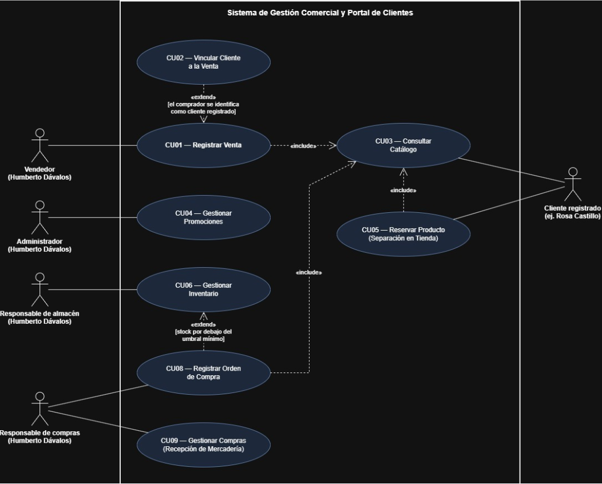

# Casos de uso de Comercial Nazareth

Los identificadores conservan la numeración del proyecto de origen. Humberto Dávalos desempeña los cuatro roles internos; el cliente registrado utiliza el portal.

| ID | Caso de uso | Actor | Requisitos relacionados |
|---|---|---|---|
| CU-001 | Registrar venta | Vendedor | REQ-001; utiliza REQ-007 y, cuando el comprador se identifica, REQ-010 |
| CU-002 | Vincular cliente a la venta | Vendedor | REQ-010 |
| CU-003 | Consultar catálogo | Cliente registrado, Vendedor y Responsable de compras | REQ-007 |
| CU-004 | Gestionar promociones | Administrador | REQ-008 |
| CU-005 | Reservar producto (Separación en tienda) | Cliente registrado | REQ-007, REQ-009 |
| CU-006 | Gestionar inventario | Responsable de almacén | REQ-002, REQ-015 |
| CU-008 | Registrar orden de compra | Responsable de compras | REQ-003, REQ-004, REQ-007 |
| CU-009 | Gestionar compras (Recepción de mercadería) | Responsable de compras | REQ-004, REQ-005 |

## CU-001: Registrar venta

Actor: Vendedor, rol desempeñado por Humberto Dávalos.

Precondiciones: Humberto tiene una sesión administrativa activa. Los productos están activos y cuentan con precio y stock registrados.

### Flujo principal

1. Humberto consulta el catálogo mediante CU-003 y selecciona los productos y cantidades de la venta.
2. El sistema comprueba que la venta tenga productos, que las cantidades sean positivas y que exista stock suficiente.
3. Si el comprador se identifica como cliente registrado, Humberto lo vincula mediante CU-002. En caso contrario, continúa sin cliente asociado.
4. Humberto elige efectivo, Yape o Plin. El sistema calcula el total con los precios del servicio y muestra los campos del método elegido.
5. Humberto registra el monto recibido en efectivo o la referencia de la operación digital.
6. El sistema valida el monto recibido en efectivo o la referencia de la operación digital, según el método elegido, y calcula el vuelto cuando corresponde.
7. El sistema guarda la cabecera y el detalle de la venta, registra la salida de inventario y descuenta el stock en una misma transacción.
8. El sistema confirma el guardado y muestra el identificador de la venta.

### Alternativas y excepciones

| Situación | Respuesta |
|---|---|
| El comprador no se identifica como cliente registrado | Continuar sin vincular una cuenta. |
| El monto recibido en efectivo supera el total | Calcular y mostrar el vuelto. |
| Se selecciona Yape o Plin | Registrar la referencia digital sin atribuirle una confirmación bancaria automática. |
| La venta está vacía o contiene cantidades no válidas | Solicitar la corrección antes de continuar. |
| Un producto no tiene stock suficiente | Identificar el producto y rechazar el intento actual. Humberto puede iniciar una nueva selección. |
| El monto recibido o la referencia digital no son válidos para el método elegido | Solicitar la corrección antes de guardar. |
| Falla el guardado | Revertir la transacción y mostrar que la venta no fue confirmada. |

Postcondición de éxito: quedan guardados la venta, su detalle y el movimiento de salida, con el stock actualizado.

Postcondición ante fallo de guardado: no quedan una venta parcial ni descuentos de stock correspondientes a una venta sin confirmar.

CU-001 incluye CU-003. CU-002 extiende CU-001 cuando el comprador se identifica como cliente registrado.

## CU-002: Vincular cliente a la venta

Actor: Vendedor, rol desempeñado por Humberto Dávalos.

Requisito relacionado: REQ-010.

Relación: extiende CU-001 cuando el comprador se identifica como cliente registrado. La vinculación es opcional y no impide guardar la venta.

Precondiciones: Humberto tiene una sesión administrativa activa y una venta en curso en CU-001. El comprador se identifica como cliente registrado.

### Flujo principal
1. Humberto busca al cliente registrado con los datos que proporciona el comprador.
2. El sistema muestra el cliente que coincide.
3. Humberto confirma que es el cliente indicado por el comprador.
4. El sistema asocia el cliente a la venta en curso.
5. El sistema devuelve el control a CU-001, que continúa con la elección del método de pago.

### Alternativas y excepciones

| Situación | Respuesta |
|---|---|
| El comprador no se identifica | CU-002 no se ejecuta. La venta continúa sin cliente asociado. |
| El sistema no encuentra un cliente registrado con los datos indicados | Humberto repite la búsqueda o continúa la venta sin cliente asociado. |

Postcondición de éxito: la venta en curso queda asociada a un cliente registrado. La vinculación no modifica los productos, el total ni el método de pago.

Postcondición sin vinculación: la venta continúa sin cliente asociado y puede confirmarse.

## CU-003: Consultar catálogo

Actores: Cliente registrado, Vendedor y Responsable de compras.

Requisito relacionado: REQ-007.

Relación: CU-001, CU-005 y CU-008 incluyen CU-003.

Precondiciones: hay productos registrados. Para guardar favoritos y listas, el cliente registrado tiene una sesión iniciada en el portal.

### Flujo principal
1. El actor ingresa el nombre del producto, elige una categoría, o ambos.
2. El sistema busca los productos que coinciden.
3. El sistema muestra cada coincidencia con su nombre, precio y disponibilidad.
4. El cliente registrado guarda un producto en favoritos o en una lista.
5. El sistema conserva la selección en el portal del cliente.

### Alternativas y excepciones

| Situación | Respuesta |
|---|---|
| La búsqueda no tiene coincidencias | El sistema indica que no se encontraron productos. |
| El actor es el Vendedor o el Responsable de compras | Consulta precio y disponibilidad. Los favoritos y las listas pertenecen al portal del cliente registrado. |
| El actor no es un cliente registrado | Puede consultar el catálogo, pero no guardar favoritos ni listas. |
| CU-001 invoca la consulta | Humberto elige los productos y cantidades de la venta desde los resultados. |

Postcondición de éxito: el actor ve los resultados con precio y disponibilidad. Si el cliente registrado guardó favoritos o listas, quedan conservados.

## CU-004: Gestionar promociones

Actor: Administrador, rol desempeñado por Humberto Dávalos.

Requisito relacionado: REQ-008.

Precondiciones: sesión administrativa activa y producto existente.

### Flujo principal

1. Humberto selecciona el producto que tendrá la promoción.
2. Indica el tipo de descuento, porcentual o fijo, y su valor.
3. Define el inicio, el fin y el estado de la campaña.
4. El sistema calcula el precio resultante y comprueba las fechas.
5. El sistema guarda la campaña y la muestra en el listado correspondiente.

### Alternativas y excepciones

| Situación | Respuesta |
|---|---|
| Se edita una campaña existente | Conservar su identificador al guardar los cambios. |
| Humberto pausa, activa o elimina una campaña | Actualizar su estado o retirarla según la operación elegida. |
| El porcentaje supera 100 o el valor no es positivo | Rechazar el dato y solicitar corrección. |
| La fecha final es anterior a la inicial | Solicitar corregir la vigencia. |
| Faltan el producto o campos obligatorios | Impedir el guardado. |

Postcondición de éxito: la campaña conserva el tipo, el valor, la vigencia y el estado registrados. El precio promocional no puede ser negativo; el cálculo aplicado en la venta debe coincidir entre la interfaz y el servicio.

## CU-005: Reservar producto (Separación en tienda)

Actor: Cliente registrado.

Requisitos relacionados: REQ-007 y REQ-009.

Relación: incluye CU-003.

Precondiciones: sesión del cliente en el portal y productos disponibles para consultar en el catálogo.

### Flujo principal

1. El cliente ejecuta CU-003 y selecciona los productos de su solicitud.
2. El sistema calcula el importe estimado.
3. El cliente solicita la separación.
4. El sistema registra la solicitud, genera un código de recojo y muestra el estado pendiente de confirmación.
5. La atención en tienda permite comprobar la disponibilidad y concretar la venta mediante CU-001.

### Alternativas y excepciones

| Situación | Respuesta |
|---|---|
| El cliente modifica la selección antes de enviarla | Actualizar la lista y su importe estimado. |
| Se intenta superar tres productos distintos | Impedir añadir el excedente. |
| Un producto está agotado al confirmar la disponibilidad | Informar el cambio y ajustar la solicitud. |
| El código generado coincide con otro registrado | Generar un código diferente. |

Postcondición de éxito: queda registrada una solicitud con sus productos, importe estimado, código y estado. La especificación contempla hasta tres productos distintos y una vigencia de 24 horas. La solicitud no confirma una venta ni bloquea existencias.

## CU-006: Gestionar inventario

Actor: Responsable de almacén, rol desempeñado por Humberto Dávalos.

Requisitos relacionados: REQ-002 y REQ-015.

Relación: CU-008 puede extender CU-006 cuando el stock está por debajo del mínimo y Humberto decide reponer.

Precondiciones: Humberto tiene una sesión administrativa activa con acceso autorizado para el mantenimiento de productos y los ajustes de existencias. El stock inicial corresponde al conteo de productos.

### Flujo principal

1. Humberto consulta los productos y sus existencias.
2. El sistema muestra el stock y el mínimo configurado y señala los productos activos cuyo stock es menor o igual al mínimo.
3. Humberto elige consultar el historial, mantener un producto, realizar un ajuste manual o iniciar la reposición cuando corresponda.
4. Para un ajuste manual, Humberto indica el cambio de existencias y su motivo.
5. El sistema comprueba que el motivo contenga al menos un carácter distinto de espacios, que la cantidad sea válida y que el stock resultante no sea negativo.
6. El sistema guarda el ajuste y su motivo en el historial y actualiza el stock en una misma transacción.
7. El sistema confirma el ajuste. Humberto consulta el historial, que muestra sus motivos y conserva los registros anteriores.

### Alternativas y excepciones

| Situación | Respuesta |
|---|---|
| Humberto solo consulta existencias o historial | Mostrar la información sin modificar el stock. |
| Humberto mantiene un producto | Registrar el producto con precio y stock inicial, o actualizar el precio de uno existente. |
| El stock de un producto activo es igual al mínimo configurado | Mostrar la alerta; esa igualdad por sí sola no activa CU-008. |
| El stock está por debajo del mínimo y Humberto decide reponer | Ejecutar CU-008 en el rol de Responsable de compras. Registrar la orden no modifica el stock. |
| Un producto inactivo tiene stock menor o igual al mínimo | No incluirlo en la alerta. |
| El usuario no tiene acceso autorizado | Rechazar la operación sin guardar cambios. |
| El motivo está vacío o contiene únicamente espacios | Solicitar corregirlo; el stock permanece sin cambios y no se registra el ajuste. |
| La cantidad no es válida o produciría un stock negativo | Rechazar el ajuste sin modificar existencias. |
| Falla el guardado del ajuste, su motivo o el stock | Revertir la transacción; el stock y el historial conservan el estado anterior al intento. |

Postcondición de éxito: la consulta refleja las existencias; las modificaciones autorizadas quedan guardadas. Cada ajuste manual conserva su motivo en el historial, junto con los ajustes anteriores.

La exigencia del motivo corresponde a los ajustes manuales. Las salidas por ventas siguen CU-001 y las entradas por recepción siguen CU-009.

El [proceso crítico](proceso-critico.md) presenta el flujo de CU-006 y sus controles.

## CU-008: Registrar orden de compra

Actor: Responsable de compras, rol desempeñado por Humberto Dávalos.

Requisitos relacionados: REQ-003, REQ-004 y REQ-007.

Relaciones: incluye CU-003; puede extender CU-006 con stock por debajo del mínimo y decisión de reponer.

Precondiciones: sesión administrativa activa y productos existentes en el catálogo. La identificación del proveedor se completa dentro de la orden.

### Flujo principal

1. Humberto registra la razón social, el RUC y el teléfono del proveedor en la orden.
2. Ejecuta CU-003 y agrega los productos a reponer.
3. Indica la cantidad y el costo unitario por línea.
4. El sistema calcula el total estimado como la suma de cantidad por costo unitario.
5. El sistema guarda la orden pendiente. Humberto comunica el pedido al proveedor por un medio externo.

### Alternativas y excepciones

| Situación | Respuesta |
|---|---|
| Se inicia CU-008 desde CU-006 | Conservar el contexto del producto revisado y completar la orden. |
| Humberto necesita reponer sin una alerta | Iniciar CU-008 directamente. |
| Faltan datos obligatorios del proveedor | Solicitar completarlos antes de guardar. |
| La cantidad o el costo no es positivo | Rechazar la línea y señalar el campo. |
| La orden no contiene líneas | Impedir el guardado. |

Postcondición de éxito: la orden conserva proveedor, productos, cantidades, costos, total estimado y estado pendiente. Registrar la orden no modifica existencias; el incremento corresponde a CU-009. El proveedor no necesita una cuenta ni un caso de uso independiente.

## CU-009: Gestionar compras (Recepción de mercadería)

Actor: Responsable de compras, rol desempeñado por Humberto Dávalos.

Requisitos relacionados: REQ-004 y REQ-005.

Precondiciones: sesión administrativa activa, orden pendiente con saldo por recibir, mercadería verificada físicamente y referencia de recepción no utilizada.

### Flujo principal

1. Humberto selecciona la orden pendiente correspondiente a la entrega.
2. Compara los productos y cantidades con la mercadería recibida.
3. Registra las cantidades efectivamente recibidas.
4. El sistema incrementa el stock y registra un movimiento de entrada por producto en una misma transacción.
5. El sistema acumula las cantidades recibidas, actualiza el saldo y las alertas y conserva la orden pendiente o la marca recibida según corresponda.

### Alternativas y excepciones

| Situación | Respuesta |
|---|---|
| La entrega es menor que el saldo por recibir | Conservar la orden pendiente con la diferencia restante. |
| Se anula una orden sin recepciones registradas | Marcarla anulada sin modificar existencias. |
| La cantidad recibida supera el saldo de la orden | Rechazar y solicitar corrección. |
| La orden está recibida o anulada, o la referencia ya se utilizó | Impedir una entrada duplicada. |
| Falla el guardado de la recepción | Revertir las cantidades y movimientos de la operación. |

Postcondición de éxito: queda guardada una recepción sin duplicados y el stock aumenta por lo efectivamente recibido. La orden permanece pendiente si hay saldo o queda recibida cuando se completa. Una orden con entradas registradas no se anula; las devoluciones y la reversión de recepciones quedan fuera de este alcance.

## Correspondencia documental

Los casos de uso proceden del modelo y del informe de la Evaluación Parcial. CU-001, CU-002 y la consulta de catálogo conservan las reglas de la base v2.0.1. CU-006 incorpora CR-001 y los controles de inventario de la especificación del proyecto. La [convención de identificadores](convencion-ids.md) relaciona los códigos del origen con los empleados aquí.
