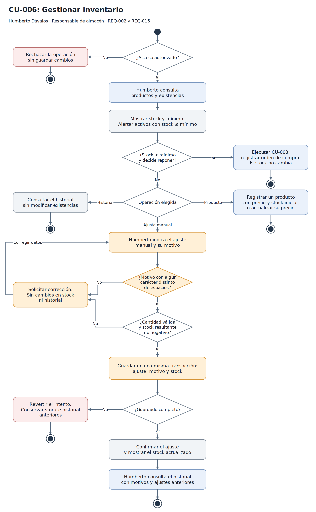

# Proceso crítico: CU-006 Gestionar inventario

## Justificación

Humberto necesita conocer las existencias para decidir qué productos comprar y en qué cantidad. La estimación visual del stock y los registros en cuadernos dificultan esa decisión. CU-006 concentra la consulta de existencias, las alertas y los ajustes manuales que permiten explicar diferencias entre el saldo registrado y los productos disponibles.

Se selecciona este proceso por su relación directa con la exactitud del inventario y la reposición del negocio. El flujo distingue una consulta, el mantenimiento del producto y un ajuste manual; también muestra cuándo puede iniciarse una orden de compra.

## Actor y relaciones

Humberto actúa como Responsable de almacén desde su sesión administrativa. CU-006 atiende REQ-002 y REQ-015. Cuando el stock está por debajo del mínimo y decide reponer, asume el rol de Responsable de compras y ejecuta CU-008. La orden no aumenta el stock; la recepción de CU-009 registra las entradas de mercadería.

## Controles del ajuste

- El motivo debe contener al menos un carácter distinto de espacios y quedar en el historial.
- Una cantidad inválida o un saldo resultante negativo impide registrar el ajuste.
- El ajuste, el motivo y el stock se confirman juntos; un fallo conserva el estado anterior.
- El historial conserva los ajustes anteriores con sus motivos.

Las salidas por ventas mantienen CU-001. El registro del motivo corresponde a los ajustes manuales de REQ-015.

## Diagrama de flujo

- [Archivo editable de draw.io](../modelos/actividad-gestionar-inventario.drawio).
- [XML del diagrama](../modelos/actividad-gestionar-inventario.xml).
- [Exportación PNG](../modelos/actividad-gestionar-inventario.png).

Los tres archivos representan el mismo flujo. La consulta conserva las reglas de alertas para productos activos; los ajustes incorporan los controles de CR-001.

## Trazabilidad

| Requisito | Caso de uso | Clases del alcance seleccionado | Pruebas |
|---|---|---|---|
| REQ-002 | CU-006 | CLS-Producto | PRU-002 |
| REQ-015 | CU-006 | CLS-Producto, CLS-MovimientoInventario | PRU-016, PRU-017, PRU-018, PRU-019 |

PRU-016 describe ajustes con motivos válidos y conservación del historial. PRU-017 y PRU-018 cubren motivos vacíos o compuestos solo por espacios. PRU-019 define el resultado esperado ante un fallo durante el guardado del ajuste.
